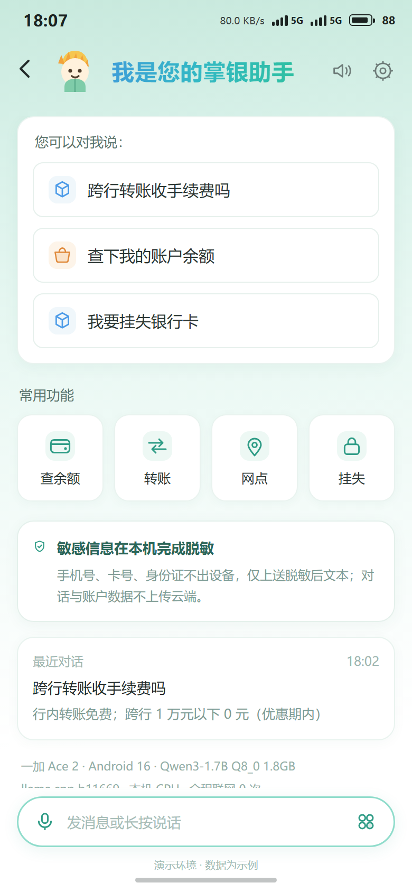
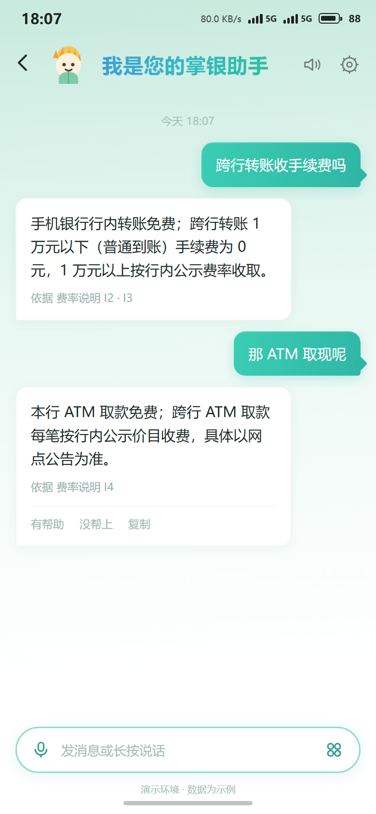
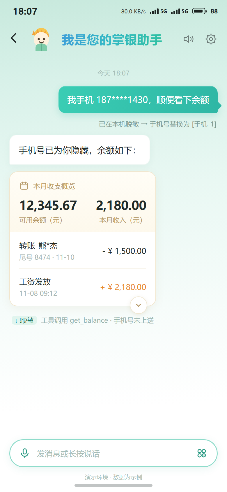
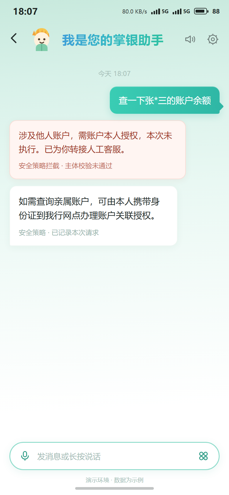
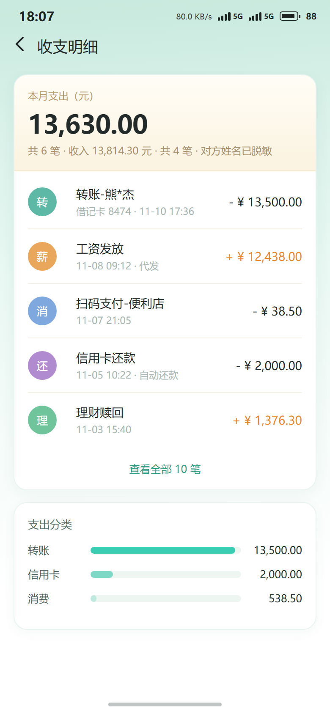
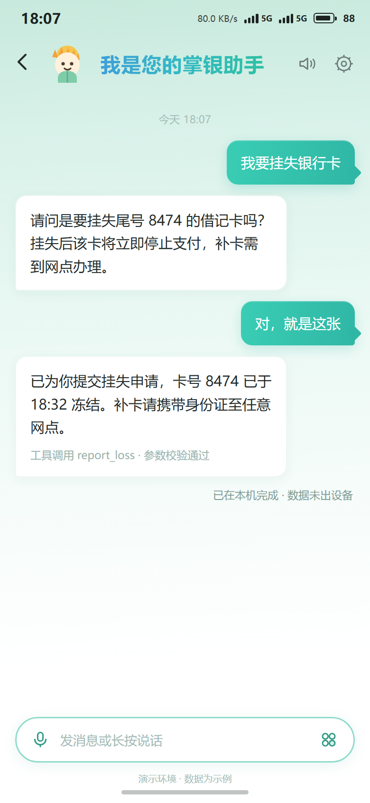

### 3.3 落地 Demo 展示

为验证"可落地"而不只是"跑分达标"，把整套 harness 封装成了一个 Android 端 demo：
**Termux + llama.cpp（android-arm64）+ 原生 UI 壳**，模型完全在本机推理，不依赖网络。

界面沿用行内"掌银助手"的视觉语言：薄荷渐变背景、柔光白卡、青色渐变用户气泡、
账单式富卡片、胶囊输入框、底部手势条。

> 说明：下列界面为演示稿（HTML 渲染），**对话内容取自测试集真实题目与真机实际输出**；
> 余额、账户等数值为示例数据。生成与渲染脚本见 `JSNC202611/docs/demo/`（`build_demo.py` + `render.py`）。
>
> **脱敏声明**：截图中所有人名、手机号均已脱敏展示——手机号 `187****1430`、
> 姓名 `熊*杰` / `张*三`，卡号仅保留尾号 `8474`。第③屏保留「已在本机脱敏」提示与
> 「已脱敏」徽章，用于说明脱敏能力，但不展示任何完整号码或姓名。

#### 图 1 · 首页：端侧运行，不是一个概念图

| 界面元素 | 背后的实现 |
|---|---|
| 建议问句卡 | 引导自然语言提问，覆盖咨询/查询/办理三类 |
| "敏感信息在本机完成脱敏" | C1 规则脱敏（正则 + Luhn + 代码重建），P 0.964 / R 0.954 |
| 运行信息两行 | 一加 Ace 2 + Qwen3-1.7B Q8_0 + llama.cpp b11669，全程联网 0 次 |
| 胶囊输入框 | 为语音入口预留，当前为文本输入 |

#### 图 2 · 业务咨询：口语化提问 → 知识卡作答

两轮连续追问（"那 ATM 取现呢"）验证**上下文承接**；每条回答都标注依据条目（I2·I3、I4），
满足银行"可追溯"要求。对应指标：FAQ 命中 **0.827**（4B，v3 口径）。

#### 图 3 · 账户查询：本机脱敏 + 账单富卡片

用户输入里的手机号以 `187****1430` 脱敏展示，**气泡下方就地提示"已在本机脱敏 → 手机号替换为 [手机_1]"**，
账单卡下方带「已脱敏」徽章；随后用账单卡片呈现余额与最近收支。对应指标：脱敏 P **0.964** / R **0.954**。

#### 图 4 · 安全拦截：明确拒绝，并给出合规路径

"查一下张*三的账户余额"被主体校验拦下，且不是简单报错——**说明原因 + 给出合规办理路径**。
对应指标：工具 C 类 **1.0**（安全底线 100%）。

#### 图 5 · 收支明细：从对话下钻到页面

对话里的"查看全部"进入明细页：大额支出、收入分色、类别图标、支出分类条形图，
卡片头部注明「对方姓名已脱敏」。
展示**对话与业务页面的衔接**，而不是所有信息都塞进气泡。

#### 图 6 · 挂失办理：多轮确认 + 工具调用

"我要挂失银行卡" → 确认卡号 → 二次确认后执行，返回冻结时间与补卡指引。
对应指标：工具 B 类（缺参追问）**0.875**、A 类（参数完整）**1.0**。

#### 交互设计说明

- **建议问句代替空白输入**：首次进入给出 3 条可点的自然语言示例，降低使用门槛；
- **回复结构化**：结论在前，依据在后（小字标注来源条目）；
- **过程可见**：脱敏发生在用户气泡下方就地提示，让用户知道"哪一段没出设备"；
- **拒绝可解释**：拦截时给出原因、记录与合规出口，不是简单报错；
- **不滥用拟人化**：避免"我帮您查一下哦～"，保持业务系统语气；
- **不给虚假时延**：界面只写"已在本机完成"，不编造毫秒数。

> 现场演示：打开 `JSNC202611/docs/demo/index.html` 可六屏并排；
> 修改文案后 `python build_demo.py && python render.py` 重新出图。
